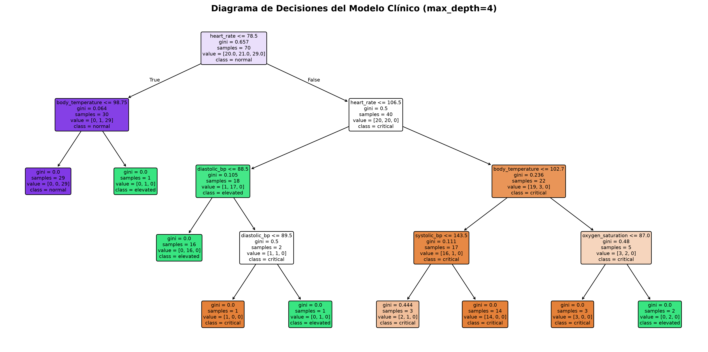

# Predicción de Nivel de Riesgo en Salud (ML_2026Q4)

Este repositorio contiene la solución modular para las **Entregas 1, 2 y 3** del curso de Machine Learning. El proyecto establece un pipeline de datos ejecutable y reproducible en Python, encargándose de la carga automatizada de datos, la ingeniería de características clínicas, la construcción de modelos predictivos, la validación cruzada y la generación de reportes resumidos.

---

## 🎯 Objetivo de la Actividad 1
Implementar y automatizar un flujo de trabajo reproducible que permita:
1. Crear el repositorio y registrar avances.
2. Crear una clase que obtenga un DataFrame desde Hugging Face.
3. Crear una clase que resuma un DataFrame en un `.txt`.
4. Coordinar las dos clases y transformar los datos.

## 🎯 Objetivo de la Actividad 2
Implementar un flujo de trabajo reproducible que permita:
1. **Construcción automática del DataFrame**: Obtención de datos clínicos directamente desde Hugging Face Datasets sin descargas manuales.
2. **Preprocesamiento y Limpieza**: Separación de variables de presión arterial (`blood_pressure`), eliminación de metadatos no clínicos (`idx`, `timestamp`) y mitigación de fuga de datos (*data leakage*).
3. **Modelo de Regresión Lineal**: Predicción del Índice de Masa Corporal (`bmi`) a partir de la edad (`age`) e interpretación de métricas ($R^2$, MAE, RMSE).
4. **Modelo de Clasificación (Random Forest)**: Clasificación de categorías de riesgo clínico (`risk_category`) optimizando el *Recall* en la categoría Crítica.
5. **Generación de Reportes Automatizados**: Exportación automática de resúmenes interpretativos en archivos `.txt`.
6. **Integración CI/CD**: Ejecución automatizada de todo el pipeline mediante GitHub Actions (`ejecutando WF tareas`).

## 🎯 Objetivo de la Actividad 3
Implementar, validar y documentar un modelo interpretable de clasificación mediante **Árboles de Decisión**:
1. **Modelado Orientado a Objetos (`ArbolDecision`)**: Encapsular el preprocesamiento, división estratificada 70/30, validación cruzada ($k=5$), análisis de profundidad (`max_depth`) y visualización del árbol.
2. **Visualización y Explicabilidad**: Exportar el diagrama gráfico del árbol (`arbol_decision.png`) y sus reglas lógicas.
3. **Reportes Clínicos Automatizados (`ReporteArbol`)**: Generar reportes dinámicos en `.txt` que incluyan la pregunta de negocio, enlace al dataset, hiperparámetros, resultados de validación cruzada y métricas por categoría.
4. **Publicación de Artefactos en CI/CD**: Empaquetar los reportes `.txt`, gráficas `.png` y notebooks ejecutados como artefactos descargables en GitHub Actions (`resultados-actividad-3`).

---

## 👥 Integrantes del Grupo
- Juan Fernando Cataño Higuita
- Juan David Ramírez García

## 👨‍🏫 Docente 
Andrés Felipe Callejas Jaramillo

---

# 🩺 Predicción de Nivel de Riesgo en Salud y Modelado Predictivo

## 📊 Documentación del Dataset Utilizado

- **Fuente**: Hugging Face Datasets
- **Dataset Actividad 3**: [`infinite-dataset-hub/HealthVitalSigns`](https://huggingface.co/datasets/infinite-dataset-hub/HealthVitalSigns)
- **Dataset Actividades 1 y 2**: Health Vital Signs & Risk Predictor
- **Dimensiones y Calidad (`HealthVitalSigns`)**: 100 registros clínicos y 7 columnas originales, sin valores nulos ni filas duplicadas.
- **Variables principales**:
  - `heart_rate`: Ritmo cardíaco en latidos por minuto (bpm).
  - `blood_pressure`: Presión arterial dividida durante el preprocesamiento en `systolic_bp` (sistólica) y `diastolic_bp` (diastólica).
  - `oxygen_saturation`: Porcentaje de saturación de oxígeno en sangre ($\text{SpO}_2$).
  - `body_temperature`: Temperatura corporal en grados Fahrenheit.
  - `risk_category` (antes `label`): Variable objetivo con la categoría de riesgo clínico (*normal*, *elevated*, *critical*).
  - `age` y `bmi`: Variables empleadas en el modelo de Regresión Lineal de la Actividad 2.

---

## ❓ Pregunta de Negocio

**¿Podemos predecir en tiempo real si un paciente requiere atención Normal, Elevada o Crítica analizando sus signos vitales?**

- **¿Quién se beneficia?**: El equipo médico y el personal de triaje en salas de urgencias u hospitales.
- **¿Qué decisión apoya?**: Clasificar y priorizar la atención de los pacientes según su gravedad. Permite asignar atención inmediata a quienes estén en estado crítico, optimizar los recursos del hospital y reducir tiempos de espera en emergencias.

---

## 🧠 Selección y Justificación del Modelo e Hiperparámetros

- **Tipo de aprendizaje y justificación**: Usamos un modelo de **aprendizaje supervisado** llamado **Árbol de Decisión** (`DecisionTreeClassifier`) porque el conjunto de datos cuenta con las etiquetas de riesgo clínico que responden directamente a la pregunta de negocio. Además, ofrece reglas explícitas fáciles de auditar por personal médico.
- **Variables elegidas**:
  - **Variable Objetivo (`risk_category`)**: Etiquetas *normal*, *elevated* y *critical*.
  - **Variables Predictoras (`heart_rate`, `systolic_bp`, `diastolic_bp`, `oxygen_saturation`, `body_temperature`)**: Signos vitales fisiológicos directos para evaluar la gravedad del paciente.
- **Justificación de `max_depth` mediante Validación Cruzada (5 Pliegues)**:
  Se evaluaron profundidades de `1` a `6` comparando el rendimiento en entrenamiento frente a validación cruzada estratificada sobre los 100 registros:

  | `max_depth` | Train Accuracy (%) | CV Accuracy (%) | CV Std (±%) | CV F1-Macro |
  | :---: | :---: | :---: | :---: | :---: |
  | 1 | 70.50% | 68.00% | ± 2.45% | 0.5355 |
  | 2 | 94.00% | 88.00% | ± 6.00% | 0.8676 |
  | 3 | 94.00% | 87.00% | ± 6.78% | 0.8553 |
  | **4** | **97.75%** | **85.00%** | **± 8.37%** | **0.8352** |
  | 5 | 98.25% | 85.00% | ± 8.37% | 0.8350 |
  | 6 | 99.50% | 84.00% | ± 7.35% | 0.8226 |

  Con `max_depth=1` el modelo presenta subajuste (*underfitting*). Con `max_depth=4` el árbol logra capturar las interacciones entre frecuencia cardíaca, temperatura, saturación de oxígeno y presión arterial sin llegar a la memorización extrema de profundidades mayores (`5` o `6`), donde el entrenamiento sube a `99.50%` mientras la validación cruzada desciende.

---

## 🌲 Funcionamiento del Modelo

### Visualización del Árbol de Decisión



El árbol de decisión funciona respondiendo preguntas cerradas sobre los signos vitales del paciente. En el primer nivel, el algoritmo evalúa todas las variables y selecciona aquella que mejor separa las categorías de riesgo (por ejemplo, evaluando umbrales de frecuencia cardíaca).

Al responder **Sí** o **No**, divide a los pacientes en dos subgrupos. En los niveles siguientes repite el mismo proceso dentro de cada rama analizando las demás variables (temperatura, presión arterial y saturación de oxígeno) hasta llegar a los nodos hoja, donde asigna la categoría de riesgo final (*normal*, *elevated* o *critical*).

---

## 📈 Resultados e Interpretación de Métricas Clínicas

Para evitar depender únicamente de un corte pequeño, se combinó una **Validación Cruzada Estratificada de 5 pliegues** (sobre los 100 registros) con una **evaluación Hold-out estratificada 70/30** (70 entrenamiento / 30 prueba):

- **Accuracy**: El modelo acertó la categoría correcta en el **87%** de los pacientes evaluados en la prueba, es decir, en 26 de 30 casos. Además, al aplicar validación cruzada de 5 pliegues sobre los 100 registros del dataset, el acierto promedio fue del **85%** (± 8.37%). Aunque es un buen comportamiento inicial, los resultados podrían cambiar al evaluar un volumen de datos mucho mayor.
- **Recall**: Mide cuántos casos reales de una categoría logró capturar el modelo sin pasarlos por alto. Un **0.89 (89%)** en la clase `critical` significa que detectó a 8 de los 9 pacientes graves reales en la prueba y dejó pasar 1 caso, por lo que hay que tener precaución y mantener siempre la supervisión médica.
- **Precisión**: Mide el porcentaje de acierto en las alarmas que enciende el modelo. Un **0.80** en `critical` significa que acertó en 4 de cada 5 alertas de paciente grave (8 aciertos de 10 alertas), clasificando por precaución a 2 pacientes de riesgo *elevated* como si fueran *critical*.
- **F1-Score**: Mide el balance entre los casos reales capturados (Recall) y las falsas alarmas evadidas (Precisión). Un promedio macro de **0.86** en la prueba (y **0.84** en validación cruzada) indica que el modelo mantiene un equilibrio estable entre sus aciertos y fallos en todas las categorías, dentro de las limitaciones de contar con pocos datos.
- **Importancia de Variables**: Mide el porcentaje de influencia que tuvo cada signo vital en las decisiones del árbol:
  - `heart_rate` (Frecuencia Cardíaca): **82.82%**
  - `body_temperature` (Temperatura Corporal): **6.35%**
  - `oxygen_saturation` (Saturación de Oxígeno): **5.38%**
  - `diastolic_bp` / `systolic_bp` (Presión Arterial): **5.46%** (`4.23%` diastólica y `1.23%` sistólica)

---

## 📋 Hallazgos y Conclusiones del Negocio

### Respuesta a la Pregunta de Negocio
**¿Podemos predecir en tiempo real si un paciente requiere atención Normal, Elevada o Crítica analizando sus signos vitales?**

De forma preliminar sí. El modelo muestra que analizando la frecuencia cardíaca, la temperatura corporal, la saturación de oxígeno y la presión arterial es posible clasificar el nivel de riesgo con un **87%** de acierto en prueba y un **85%** en validación cruzada. Sin embargo, debido al tamaño reducido del dataset, los resultados deben usarse con precaución y únicamente como apoyo al criterio clínico.

---

### Hallazgos Principales

- En el conjunto de prueba de 30 pacientes, el modelo alcanzó un Recall de 0.89 en la categoría crítica, identificando correctamente a 8 de los 9 pacientes graves reales y omitiendo 1 caso.
- La frecuencia cardíaca (`heart_rate`) concentró el 82.82% del peso en las decisiones del árbol, seguida por la temperatura corporal (6.35%), la presión arterial (5.46%) y la saturación de oxígeno (5.38%).
- La precisión en la categoría crítica fue de 0.80, lo que indica que de 10 alertas de paciente crítico, 8 correspondieron a casos graves reales y 2 fueron pacientes de riesgo elevado clasificados como críticos por precaución.
- El F1-Score macro fue de 0.86 en la prueba y 0.84 en la validación cruzada, mostrando un desempeño consistente entre las tres categorías dentro de esta muestra.

---

### Confiabilidad, Limitaciones y Oportunidades

- Los resultados deben tomarse con precaución debido a que el dataset cuenta con solo 100 registros totales (30 en prueba). Con pocos datos, el modelo es sensible a variaciones en la muestra y sus métricas podrían cambiar significativamente al enfrentarse a un volumen de pacientes mucho mayor y más diverso.
- El hecho de que en la prueba se haya omitido 1 de los 9 casos críticos confirma que el modelo no es infalible y no puede operar de forma autónoma sin supervisión médica.
- Existe la oportunidad de ampliar el conjunto de datos con registros hospitalarios reales y evaluar ajustes en los pesos de clase (`class_weight`) o en la profundidad del árbol para reducir al mínimo los falsos negativos en pacientes críticos antes de considerar cualquier uso operativo.

---

### Recomendaciones

1. Utilizar el modelo exclusivamente como herramienta de apoyo preliminar en triaje bajo validación constante del personal médico.
2. Ampliar el dataset con más registros de urgencias para reentrenar el modelo y verificar la estabilidad de las métricas antes de cualquier despliegue.

---

## 📁 Estructura del Repositorio

```text
.
├── .github/
│   └── workflows/
│       └── ejecutar_WF_actividad_1.yml       # Workflow CI/CD y publicación de artefactos
├── src/
│   ├── clases_po/                             # Módulos Python orientados a objetos
│   │   ├── __init__.py
│   │   ├── hf_loader.py                       # Carga de datos desde Hugging Face
│   │   ├── clasificacion_riesgo.py            # Modelo Random Forest
│   │   ├── arbol_decision.py                  # Modelo Árbol de Decisión + CV + max_depth
│   │   ├── Reporte_clasificacion.py           # Reportes .txt para Random Forest
│   │   ├── reporte_arbol.py                   # Reportes .txt dinámicos para Árbol de Decisión
│   │   └── Reporte_regresion.py               # Reportes .txt para Regresión
│   └── sincronicas/
│       ├── datos/
│       │   ├── health_risk_predictor.csv      # Dataset Actividades 1 y 2
│       │   └── healthvitalSigns.csv           # Dataset Actividad 3
│       ├── reportes/
│       │   ├── health_risk_predictor.