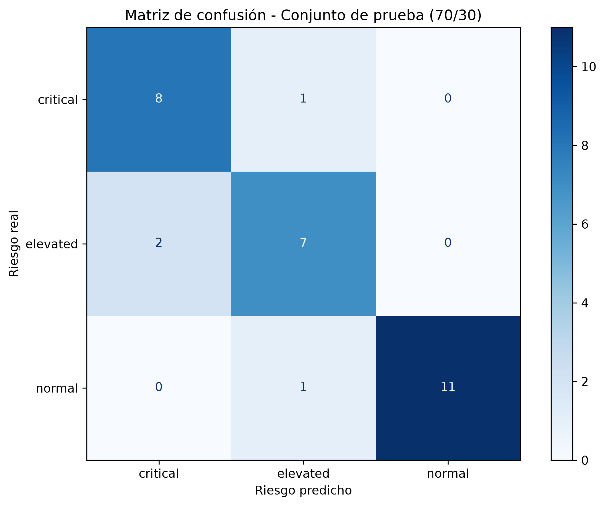

# Predicción de Nivel de Riesgo en Salud (ML_2026Q4)

Este repositorio contiene la solución modular para las **Entregas 1, 2 y 3** del curso de Machine Learning. El proyecto establece un pipeline de datos ejecutable y reproducible en Python, encargándose de la carga automatizada de datos, la ingeniería de características clínicas, la construcción de modelos predictivos, la validación cruzada y la generación de reportes resumidos.

---

## 🎯 Objetivo de la Actividad 1
Implementar y automatizar un flujo de trabajo reproducible que permita:
1. Crear el repositorio y registrar avances.
2. Crear una clase que obtenga un DataFrame desde Hugging Face.
3. Crear una clase que resuma un DataFrame en un `.txt`.
4. Coordinar las dos clases y transformar los datos.

## 🎯 Objetivo de la Actividad 2
Implementar un flujo de trabajo reproducible que permita:
1. **Construcción automática del DataFrame**: Obtención de datos clínicos directamente desde Hugging Face Datasets sin descargas manuales.
2. **Preprocesamiento y Limpieza**: Separación de variables de presión arterial (`blood_pressure`), eliminación de metadatos no clínicos (`idx`, `timestamp`) y mitigación de fuga de datos (*data leakage*).
3. **Modelo de Regresión Lineal**: Predicción del Índice de Masa Corporal (`bmi`) a partir de la edad (`age`) e interpretación de métricas ($R^2$, MAE, RMSE).
4. **Modelo de Clasificación (Random Forest)**: Clasificación de categorías de riesgo clínico (`risk_category`) optimizando el *Recall* en la categoría Crítica.
5. **Generación de Reportes Automatizados**: Exportación automática de resúmenes interpretativos en archivos `.txt`.
6. **Integración CI/CD**: Ejecución automatizada de todo el pipeline mediante GitHub Actions (`Ejecutando WF tareas`).

## 🎯 Objetivo de la Actividad 3
Implementar, validar y documentar un modelo interpretable de clasificación mediante **Árboles de Decisión**:
1. **Modelado Orientado a Objetos (`ArbolDecision`)**: Encapsular el preprocesamiento, división estratificada 70/30, validación cruzada ($k=5$), análisis de profundidad (`max_depth`) y visualización del árbol.
2. **Visualización y Explicabilidad**: Exportar el diagrama gráfico del árbol (`arbol_decision.png`) y sus reglas lógicas.
3. **Reportes Clínicos Automatizados (`ReporteArbol`)**: Generar reportes dinámicos en `.txt` que incluyan la pregunta de negocio, enlace al dataset, hiperparámetros, resultados de validación cruzada y métricas por categoría.
4. **Publicación de Artefactos en CI/CD**: Empaquetar los reportes `.txt`, gráficas `.png`, datasets `.csv` y notebooks ejecutados como artefactos descargables en GitHub Actions (`resultados-actividad-3`).

---

## 👥 Integrantes del Grupo
- Juan Fernando Cataño Higuita
- Juan David Ramírez García

## 👨‍🏫 Docente 
Andrés Felipe Callejas Jaramillo

---

# 🩺 Predicción de Nivel de Riesgo en Salud y Modelado Predictivo

## 📊 Documentación del Dataset Utilizado

- **Fuente**: Hugging Face Datasets
- **Dataset Actividad 3**: [`infinite-dataset-hub/HealthVitalSigns`](https://huggingface.co/datasets/infinite-dataset-hub/HealthVitalSigns)
- **Dataset Actividades 1 y 2**: Health Vital Signs & Risk Predictor
- **Dimensiones y Calidad (`HealthVitalSigns`)**: 100 registros clínicos y 7 columnas originales, sin valores nulos ni filas duplicadas.
- **Variables principales**:
  - `heart_rate`: Ritmo cardíaco en latidos por minuto (bpm).
  - `blood_pressure`: Presión arterial dividida durante el preprocesamiento en `systolic_bp` (sistólica) y `diastolic_bp` (diastólica).
  - `oxygen_saturation`: Porcentaje de saturación de oxígeno en sangre ($\text{SpO}_2$).
  - `body_temperature`: Temperatura corporal en grados Fahrenheit.
  - `risk_category` (antes `label`): Variable objetivo con la categoría de riesgo clínico (*normal*, *elevated*, *critical*).
  - `age` y `bmi`: Variables empleadas en el modelo de Regresión Lineal de la Actividad 2.

---

## ❓ Pregunta de Negocio

**¿Podemos predecir en tiempo real si un paciente requiere atención Normal, Elevada o Crítica analizando sus signos vitales?**

- **¿Quién se beneficia?**: El equipo médico y el personal de triaje en salas de urgencias u hospitales.
- **¿Qué decisión apoya?**: Clasificar y priorizar la atención de los pacientes según su gravedad. Permite asignar atención inmediata a quienes estén en estado crítico, optimizar los recursos del hospital y reducir tiempos de espera en emergencias.

---

## 🧠 Selección y Justificación del Modelo e Hiperparámetros

#### **4. Variables, modelo y entrenamiento**

- **Tipo de aprendizaje y justificación**: Usamos un modelo de **aprendizaje supervisado** llamado **Árbol de Decisión** (`DecisionTreeClassifier`) porque el conjunto de datos cuenta con las etiquetas de riesgo clínico que responden directamente a la pregunta de negocio. Además, ofrece reglas explícitas fáciles de auditar por personal médico.
- **Variables elegidas**:
  - **Variable Objetivo (`risk_category`)**: Etiquetas *normal*, *elevated* y *critical*.
  - **Variables Predictoras (`heart_rate`, `systolic_bp`, `diastolic_bp`, `oxygen_saturation`, `body_temperature`)**: Signos vitales fisiológicos directos para evaluar la gravedad del paciente.

| Variable | Preparación | Representación y papel en el modelo |
| :--- | :--- | :--- |
| `risk_category` | Se obtuvo renombrando `label` y normalizando las etiquetas a minúsculas. Es el resultado clínico conocido. | Variable objetivo supervisada con tres clases: `normal`, `elevated` y `critical`. |
| `heart_rate` | Se conservó como valor numérico entero en latidos por minuto. | Principal entrada fisiológica utilizada para separar frecuencias normales de patrones elevados o críticos. |
| `blood_pressure` | Se separó una sola vez en `systolic_bp` y `diastolic_bp`, ambas numéricas y expresadas en mmHg. | Aunque la fuente original contiene una cadena `sistólica/diastólica`, el modelo emplea sus dos componentes independientes. |
| `systolic_bp` | Derivada de la parte izquierda de `blood_pressure`. | Representa la presión arterial durante la contracción cardíaca. |
| `diastolic_bp` | Derivada de la parte derecha de `blood_pressure`. | Representa la presión arterial durante la relajación cardíaca. |
| `oxygen_saturation` | Se conservó como valor numérico entero de porcentaje. | Representa la saturación de oxígeno (`SpO2`) y permite detectar posibles deterioros respiratorios. |
| `body_temperature` | Se conservó como valor numérico decimal en grados Fahrenheit. | Representa la temperatura corporal y ayuda a identificar cuadros compatibles con fiebre o enfermedad. |

Se excluyeron `idx` y `timestamp` porque son metadatos de identificación y secuenciación, no medidas fisiológicas que aporten una relación estable con el riesgo. No se aplicó escalado ni normalización porque un Árbol de Decisión compara cada variable mediante umbrales independientes y no utiliza distancias. Los datos no tenían valores nulos ni duplicados, por lo que no fue necesaria imputación ni eliminación de filas.

La separación fue estratificada con **70% para entrenamiento (70 registros) y 30% para prueba (30 registros)**, usando `random_state=42`. La estratificación conserva aproximadamente la proporción de las tres clases en ambos grupos y evita que una partición aleatoria omita una categoría.
- **Justificación de `max_depth` mediante Validación Cruzada (5 Pliegues)**:
  Se evaluaron profundidades de `1` a `6` comparando el rendimiento en entrenamiento frente a validación cruzada estratificada sobre los 100 registros:

  | `max_depth` | Train Accuracy (%) | CV Accuracy (%) | CV Std ($\pm$%) | CV F1-Macro |
  | :---: | :---: | :---: | :---: | :---: |
  | 1 | 70.50% | 68.00% | $\pm$ 2.45% | 0.5355 |
  | 2 | 94.00% | 88.00% | $\pm$ 6.00% | 0.8676 |
  | 3 | 94.00% | 87.00% | $\pm$ 6.78% | 0.8553 |
  | **4** | **97.75%** | **85.00%** | **$\pm$ 8.37%** | **0.8352** |
  | 5 | 98.25% | 85.00% | $\pm$ 8.37% | 0.8350 |
  | 6 | 99.50% | 84.00% | $\pm$ 7.35% | 0.8226 |

  Con `max_depth=1` el modelo presenta subajuste (*underfitting*). Con `max_depth=4` el árbol logra capturar las interacciones entre frecuencia cardíaca, temperatura, saturación de oxígeno y presión arterial sin llegar a la memorización extrema de profundidades mayores (`5` o `6`), donde el entrenamiento sube a `99.50%` mientras la validación cruzada desciende.

---

## 🌲 Funcionamiento del Modelo

### Visualización del Árbol de Decisión


El árbol de decisión funciona respondiendo preguntas cerradas sobre los signos vitales del paciente. En el primer nivel, el algoritmo evalúa todas las variables y selecciona aquella que mejor separa las categorías de riesgo (por ejemplo, evaluando umbrales de frecuencia cardíaca).

Al responder **Sí** o **No**, divide a los pacientes en dos subgrupos. En los niveles siguientes repite el mismo proceso dentro de cada rama analizando las demás variables (temperatura, presión arterial y saturación de oxígeno) hasta llegar a los nodos hoja, donde asigna la categoría de riesgo final (*normal*, *elevated* o *critical*).

---

## 📈 Resultados e Interpretación de Métricas Clínicas

#### **5. Métricas y resultados**

Para evitar depender únicamente de un corte pequeño, se combinó una **Validación Cruzada Estratificada de 5 pliegues** (sobre los 100 registros) con una **evaluación Hold-out estratificada 70/30** (70 entrenamiento / 30 prueba):

- **Accuracy**: El modelo acertó la categoría correcta en el **87%** de los pacientes evaluados en la prueba, es decir, en 26 de 30 casos. Además, al aplicar validación cruzada de 5 pliegues sobre los 100 registros del dataset, el acierto promedio fue del **85%** ($\pm$ 8.37%). Aunque es un buen comportamiento inicial, los resultados podrían cambiar al evaluar un volumen de datos mucho mayor.
- **Recall**: Mide cuántos casos reales de una categoría logró capturar el modelo sin pasarlos por alto. Un **0.89 (89%)** en la clase `critical` significa que detectó a 8 de los 9 pacientes graves reales en la prueba y dejó pasar 1 caso, por lo que hay que tener precaución y mantener siempre la supervisión médica.
- **Precisión**: Mide el porcentaje de acierto en las alarmas que enciende el modelo. Un **0.80** en `critical` significa que acertó en 4 de cada 5 alertas de paciente grave (8 aciertos de 10 alertas), clasificando por precaución a 2 pacientes de riesgo *elevated* como si fueran *critical*.
- **F1-Score**: Mide el balance entre los casos reales capturados (Recall) y las falsas alarmas evadidas (Precisión). Un promedio macro de **0.86** en la prueba (y **0.84** en validación cruzada) indica que el modelo mantiene un equilibrio estable entre sus aciertos y fallos en todas las categorías, dentro de las limitaciones de contar con pocos datos.
- **Importancia de Variables**: Mide el porcentaje de influencia que tuvo cada signo vital en las decisiones del árbol:
  - `heart_rate` (Frecuencia Cardíaca): **82.82%**
  - `body_temperature` (Temperatura Corporal): **6.35%**
  - `oxygen_saturation` (Saturación de Oxígeno): **5.38%**
  - `diastolic_bp` / `systolic_bp` (Presión Arterial): **5.46%** (`4.23%` diastólica y `1.23%` sistólica)

### Representaciones gráficas

#### Árbol de decisión


El diagrama del árbol muestra los umbrales evaluados por el modelo, las variables seleccionadas en cada división y la clase asignada en las hojas. Las ramas representan respuestas de Sí/No, los nodos contienen el criterio utilizado y el color indica la predominancia de una clase de riesgo.

#### Matriz de confusión



La matriz de confusión debe interpretarse con:

- **Eje X**: riesgo predicho por el modelo.
- **Eje Y**: riesgo real registrado en el dataset.
- **Diagonal**: clasificaciones correctas.
- **Celdas fuera de la diagonal**: errores de clasificación.

En la evaluación 70/30 fueron correctos 8 de 9 casos críticos, 7 de 9 elevados y 11 de 12 normales. Los casos críticos omitidos fueron 1 elevado y los casos críticos se confundieron 2 veces con elevados.

### Resultados del reporte automático

El [reporte completo del Árbol de Decisión](src/sincronicas/reportes/reporte_arbol_decision.txt) documenta:

- **Modelo:** `DecisionTreeClassifier` supervisado con `criterion=gini`, `max_depth=4`, `min_samples_split=2`, `min_samples_leaf=1` y `random_state=42`.
- **Validación:** validación cruzada estratificada de 5 pliegues sobre los 100 registros, con accuracy promedio de **85%** ($\pm$ 8.37%), F1-Macro de **0.8352** y precisión macro de **0.8487**.
- **Hold-out:** separación estratificada 70/30; accuracy global de **0.87**, F1-Macro de **0.86**, precisión crítica de **0.80** y recall crítico de **0.89**.
- **Variables:** `heart_rate` tuvo una importancia de **82.82%**, `body_temperature` 6.35%, `oxygen_saturation` 5.38%, `diastolic_bp` 4.23% y `systolic_bp` 1.23%.
- **Inferencia:** 3 de los 4 pacientes no vistos fueron clasificados correctamente. El modelo detectó al paciente crítico, acertó dos casos elevados y clasificó como elevado un caso real normal.
- **Limitación:** el modelo omite un caso crítico real en la prueba y las hojas reportan confianza del 100% por pureza de la muestra pequeña, no por certeza clínica absoluta.

---

## 📋 Hallazgos y Conclusiones del Negocio

#### **6. Respuesta de negocio y recomendaciones basadas en datos**

### Respuesta a la Pregunta de Negocio
**¿Podemos predecir en tiempo real si un paciente requiere atención Normal, Elevada o Crítica analizando sus signos vitales?**

**Sí, de forma preliminar como herramienta de apoyo en triaje.** Al someter el árbol entrenado a **4 pacientes reales del conjunto de prueba (`X_test`) que el modelo nunca vio durante el entrenamiento**, el sistema clasificó cada ingreso de manera inmediata acertando en **3 de los 4 casos**:

- **Paciente #52** (`FC`: 90 bpm, `SpO2`: 96%, `Temp`: 99.2 °F, `PA`: 134/87 mmHg) $\rightarrow$ Riesgo real: **`elevated`** | Predicción: **`elevated`** *(Acierto)*.
- **Paciente #94** (`FC`: 66 bpm, `SpO2`: 99%, `Temp`: 98.9 °F, `PA`: 121/81 mmHg) $\rightarrow$ Riesgo real: **`normal`** | Predicción: **`elevated`** *(Falso positivo preventivo: su presión arterial de 121/81 mmHg supera ligeramente el umbral estándar de 120/80 mmHg)*.
- **Paciente #70** (`FC`: 116 bpm, `SpO2`: 95%, `Temp`: 101.7 °F, `PA`: 144/91 mmHg) $\rightarrow$ Riesgo real: **`critical`** | Predicción: **`critical`** *(Acierto: detecta correctamente el cuadro grave)*.
- **Paciente #49** (`FC`: 89 bpm, `SpO2`: 97%, `Temp`: 99.1 °F, `PA`: 127/83 mmHg) $\rightarrow$ Riesgo real: **`elevated`** | Predicción: **`elevated`** *(Acierto)*.

*(Nota técnica: La confianza del `100%` reportada en las hojas del árbol responde a que, con `max_depth=4` sobre 70 registros de entrenamiento, las hojas alcanzan pureza total `gini=0.0`, no a infalibilidad clínica).* Estos resultados confirman que el modelo asigna prioridades de atención en milisegundos con reglas auditables, pero debe operar siempre bajo supervisión del personal médico.

---

### Hallazgos Principales

- En el conjunto de prueba de 30 pacientes, el modelo alcanzó un Recall de 0.89 en la categoría crítica, identificando correctamente a 8 de los 9 pacientes graves reales y omitiendo 1 caso.
- La frecuencia cardíaca (`heart_rate`) concentró el 82.82% del peso en las decisiones del árbol, seguida por la temperatura corporal (6.35%), la presión arterial (5.46%) y la saturación de oxígeno (5.38%).
- La precisión en la categoría crítica fue de 0.80, lo que indica que de 10 alertas de paciente crítico, 8 correspondieron a casos graves reales y 2 fueron pacientes de riesgo elevado clasificados como críticos por precaución.
- El F1-Score macro fue de 0.86 en la prueba y 0.84 en la validación cruzada, mostrando un desempeño consistente entre las tres categorías dentro de esta muestra.

---

### Confiabilidad, Limitaciones y Oportunidades

- Los resultados deben tomarse con precaución debido a que el dataset cuenta con solo 100 registros totales (30 en prueba). Con pocos datos, el modelo es sensible a variaciones en la muestra y sus métricas podrían cambiar significativamente al enfrentarse a un volumen de pacientes mucho mayor y más diverso.
- El hecho de que en la prueba se haya omitido 1 de los 9 casos críticos confirma que el modelo no es infalible y no puede operar de forma autónoma sin supervisión médica.
- Existe la oportunidad de ampliar el conjunto de datos con registros hospitalarios reales y evaluar ajustes en los pesos de clase (`class_weight`) o en la profundidad del árbol para reducir al mínimo los falsos negativos en pacientes críticos antes de considerar cualquier uso operativo.

---

### Recomendaciones

1. **Implementación responsable:** el personal de triaje puede usar el modelo como priorización preliminar, pero el equipo médico de urgencias debe validar y confirmar la categoría antes de cualquier atención definitiva. Esta acción se sustenta en el Recall crítico de 0.89 y en la existencia de un caso crítico no detectado.
2. **Monitoreo responsable:** el líder del servicio de urgencias debe registrar predicciones, resultados reales y casos discordantes. Así podrá detectar cambios del desempeño y actualizar procedimientos antes de ampliar el uso del modelo.
3. **Mejora responsable:** el equipo de ciencia de datos y el área clínica deben ampliar el dataset con registros hospitalarios diversos, comprobar la calibración y evaluar `class_weight` o ajustes que reduzcan los falsos negativos críticos. Esta medida responde a la muestra limitada de 100 registros y a la inestabilidad observada por validación cruzada.

---

## ⚙️ Ejecución del Proyecto y Artefactos (CI/CD)

### 1. Ejecución Automática en GitHub Actions y Artefactos
Cada `git push` hacia la rama `main` activa automáticamente el workflow [`.github/workflows/ejecutar_WF_actividad_1.yml`](.github/workflows/ejecutar_WF_actividad_1.yml), el cual instala las dependencias, descarga los datasets desde Hugging Face, preprocesa los datos, entrena y evalúa los modelos, genera los reportes `.txt` junto con las gráficas `.png` y publica los resultados.

- **Enlace a ejecución exitosa:** [Ver corrida en GitHub Actions (`runs/43338562958`)](https://github.com/JuanDavidRamirezGarcia/ML_2026Q4/actions/runs/43338562958)
- **Artefacto descargable:** **`resultados-actividad-3`** (empaqueta los 8 archivos generados —reportes `.txt`, gráfica `.png`, datasets `.csv` y notebooks ejecutados— disponible en la sección *Artifacts* al final de la página de la ejecución).
- **Copia directa en el repositorio:** [`src/sincronicas/reportes/reporte_arbol_decision.txt`](src/sincronicas/reportes/reporte_arbol_decision.txt) y [`src/sincronicas/reportes/arbol_decision.png`](src/sincronicas/reportes/arbol_decision.png).

### 2. Ejecución Local (VS Code / Terminal)
1. **Clonar el repositorio:**
   ```bash
   git clone https://github.com/JuanDavidRamirezGarcia/ML_2026Q4.git
   cd ML_2026Q4
   ```
2. **Crear y activar el entorno virtual:**
   ```bash
   python -m venv .venv
   # En Windows (PowerShell):
   .venv\Scripts\Activate.ps1
   # En Linux / macOS:
   source .venv/bin/activate
   ```
3. **Instalar dependencias:**
   ```bash
   pip install -r requirements.txt
   ```
4. **Ejecutar el flujo de la Actividad 3:**
   Abre `src/sincronicas/evidencia3_arbol_decision.ipynb`, selecciona el kernel `.venv` y haz clic en **Run All**. Esto actualizará automáticamente `src/sincronicas/reportes/reporte_arbol_decision.txt` y `src/sincronicas/reportes/arbol_decision.png`.

---

## 📁 Estructura del Repositorio

```text
.
├── .github/
│   └── workflows/
│       └── ejecutar_WF_actividad_1.yml       # Workflow CI/CD y publicación de artefactos
├── src/
│   ├── clases_po/                             # Módulos Python orientados a objetos
│   │   ├── __init__.py
│   │   ├── hf_loader.py                       # Carga de datos desde Hugging Face
│   │   ├── clasificacion_riesgo.py            # Modelo Random Forest
│   │   ├── arbol_decision.py                  # Modelo Árbol de Decisión + CV + max_depth
│   │   ├── Reporte_clasificacion.py           # Reportes .txt para Random Forest
│   │   ├── reporte_arbol.py                   # Reportes .txt dinámicos para Árbol de Decisión
│   │   └── Reporte_regresion.py               # Reportes .txt para Regresión
│   └── sincronicas/
│       ├── datos/
│       │   ├── health_risk_predictor.csv      # Dataset Actividades 1 y 2
│       │   └── healthvitalSigns.csv           # Dataset Actividad 3
│       ├── reportes/
│       │   ├── health_risk_predictor.txt      # Resumen de ingesta
│       │   ├── reporte_clasificacion.txt     # Reporte de Random Forest
│       │   ├── reporte_arbol_decision.txt    # Reporte dinámico de Árbol de Decisión
│       │   ├── arbol_decision.png             # Diagrama gráfico del Árbol de Decisión
│       │   └── reporte_regresion.txt         # Reporte de Regresión
│       ├── evidencia3_arbol_decision.ipynb    # Notebook ejecutable Actividad 3
│       ├── Clasificacion.ipynb                # Notebook ejecutable Random Forest
│       ├── Entrega_1.ipynb                    # Notebook de ingesta y exploración
│       └── Regresion_Lineal.ipynb             # Notebook de Regresión Lineal
├── .gitignore                                 # Archivos excluidos
├── README.md                                  # Documentación general
└── requirements.txt                           # Dependencias del proyecto
```